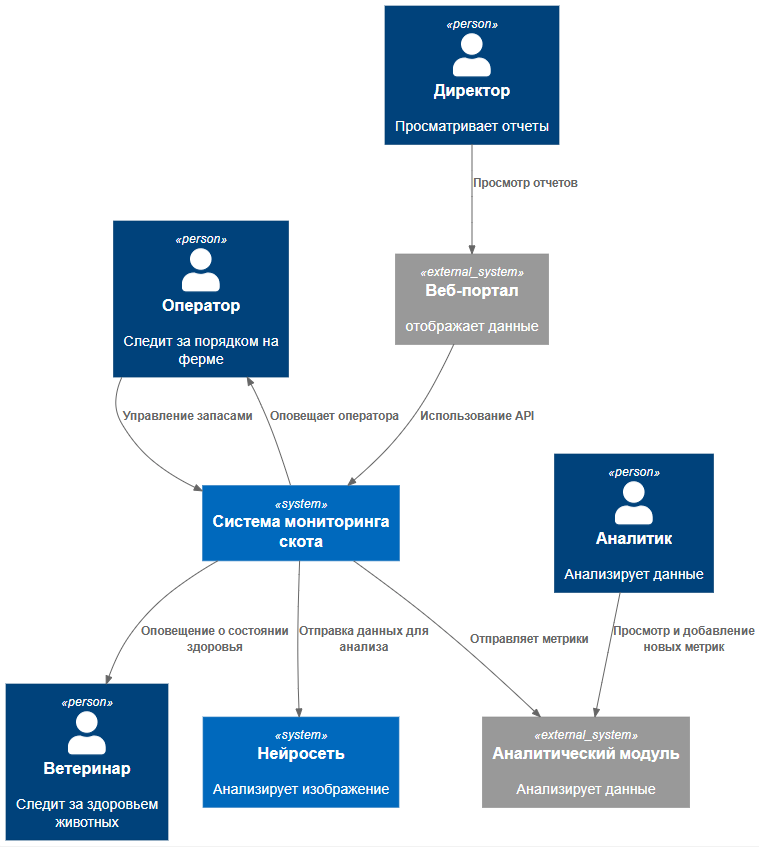
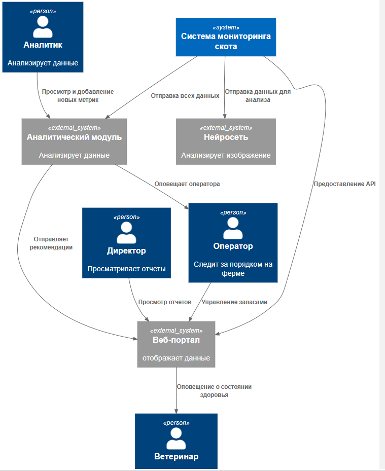

### **Спринт 1: MVP монитонинга свиноводческих ферм** 
### **Задача 1** 
### **Автор: Шиляев Константин**
### **Дата: 30.10.2026**
### **Функциональные требования**
Верхнеуровневые Use Cases: 
|**№**|**Действующие лица или системы**|**Use Case**|**Описание**|
| :-: | :- | :- | :- |
|UC1|оператор, система, AI |Оповещение оператора о животных| 1.Видеокамеры фиксируют поток,  2. Неоросети фиксируют что-то необычное(беспокойное поведение, драки, задавливание)  3. Оператор оповещается об этом (признаки задавливания)|
|UC2|оператор, система,|Оповещение оператора о технических проблемах на ферме|1. Срабатывает датчик систем фильтрации, проблем со связью.  2. Оператор оповещается 3. Оператор принимает решение |
|UC3|система, оператор|Управление запасами еды|1. Датчики в кормушках отпра вляют информацию о количестве еды  2. Аналитический модуль прогнозирует расход еды |
|UC4|система, ветеринар, нейросеть|Отслеживание состояния здоровья| 1. Видеокамеры снимают поток  2. Нейросеть оценивает состояние животных  3. Система оповещает ветеринара|
|UC5|система, аналитический модуль, нейросеть|Подсчет количества животных|1. Видеонаблюдение снимает  2. Нейросеть считает поголовье  3. Данные отправляются в аналитический модуль|
|UC6|система, аналитический модуль|Предоставление метрик| 1. Система отпарвляет метрики в аналитический модуль|
|UC7|система, аналитический модуль, аналитик| Добавление метрик|1. Аналитик описывает новую метрику   2. Система отправляет данные в аналитический модуль 3. Аналитический модуль строит метрику на основе данных|
|UC8|система, пользователи|Авторизация, разделение ролей|1. Пользователь логинится в систему  2. В зависимости от его прав предоставляется доступные ему функции|
|UC9|система, веб-портал, директор|Пользовательский интерфейс|1. Система предоставляет АПИ для мобильного приложения  2. Директор(или другой сотрудник с правами) может просматривать метрики через web-портал или мобильный телефон|
|UC9|система, веб-портал, директор|Пользовательский интерфейс|1. Система предоставляет АПИ для мобильного приложения  2. Директор(или другой сотрудник с правами) может просматривать метрики через web-портал или мобильный телефон|
|U10|оператор, система|Управление контроллерами|1. Проблема обнаружена оператором (UC1, UC2, UC3)  2. Оператор дает команду контроллерам выполнить действие: наполнить кормушку, поилку|

### **Нефункциональные требования**

|**№**|**Требование**|
| :-: | :- |
|R1|Отказоустойчивость 99,95%|
|R2|Работать даже в случае отсутствия интернета и при необходимости отправлять уведомления дежурному сотруднику на местах мониторинга, а после восстановления связи синхронизироваться с центральной системой;|
|P1|Высокая производительность,от момента возникновения нештатной ситуации, зафиксированной камерой должно проходить не более 5 секунд до момента оповещения|
|P3|Видеосистема реагирует в реальном времени (миллисекунды)|
|S1|Поддерживать необходимое количество видеокамер для аналитики в реальном времени от разных производителей|
|S2|Быть расширяемой, то есть иметь возможность разработать новый функционал без изменений существующего|
|+R1|Быть построена по принципу «центральный сервер — агенты» на конкретных фермах без ограничения количества таких агентов (в синхронизации между агентами и центральным сервером допускается задержка до 10 минут без учёта проблем со связью);|
|+R2|Есть проблемы с освещением, камеры должны снимать и в ночное время|
|+R3|Нейросетевая модель предоставляется партнерами|
|+R4|Wi-Fi нестабилен, нужны альтернативные каналы связи|
### **Решение**

+ Принцип: "Центральный сервер и агенты". Система включает в себя необходимые датчики и контроллеры, edge-архитектуру, где решение принимается непосредственно внутри контура фермы, ближе к датчикам, камерам и управляющим модулям. Это позволяет избежать проблем с недоступностью внешних систем из-за нестабильной сети.
+ Отказоустойчивость сервера достигается дублирующими серверами на фермах
+ Нейросетевая модель  предоставлена партнерами и является частью системы, расположена на сервере ферм
+ Информация с ферм синхронизируется с центральным сервером фирмы
+ Сервис оповещения находится локально на фермах, помимо уведомлений на портале, оповещения дублируются по средствам смс.
+ Существует локальный Web-портал для дежурного оператора и ветеринара на фермах.
  
### **Альтернативы**

Альтернативное решение: На фермах остаются минимальные сервисы взатимодействия с датчиками и синхронизация с центральным сервером фирмы. Остальные функции централизованы на сервере фирмы. 
+ Усиливается роль аналитического модуля
+ Усиливается роль единого web-портала
+ Отсутствует необходимость анализировать данные на стороне системы, что сокращает разработку
+ Плохо при нестабильной связи
+ Нейросетевая модель вынесена в облако (основную инфраструктуру) компании 

***Сравнение решений***
|**Вариант**|**Functional**|**Usability**|**Reliability**|**Performance**|**Supportability**|
| :-: | :- | :- | :- | :- | :- |
|Основной|Отлично|Отлично, так как сильна роль текущего Web-портала|Высокая, независимость от внешних систем|Высокая|Нужно писать с нуля|
|Альтернативный|Хорошее|Хорошее|Зависима от надежной связи с внешними системами|Невысокая|Отлично, уже существующие системы|

**Недостатки, ограничения, риски**

***Недостатки***
1. Высокая стоимость разработки, анализ данных должен происходить рядом с датчиками
